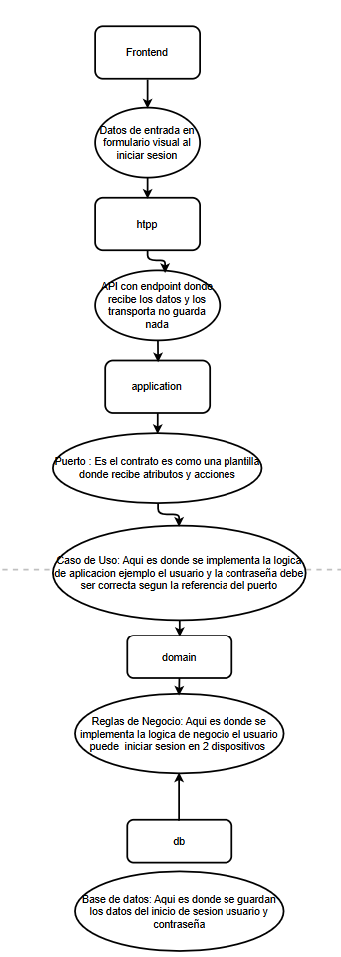

# Aprendizajes

Registro de lo aprendido en cada tarea, explicado por el responsable. Las correcciones del tutor quedan separadas para no mezclarlas con la explicación propia.

## 2026-10-20 · A1 · Estilo de arquitectura

### Explicación del responsable (diagrama v2)

| Pieza                 | Explicación                                                                                           |
| --------------------- | ----------------------------------------------------------------------------------------------------- |
| Frontend              | Datos de entrada en el formulario visual al iniciar sesión                                             |
| http                  | API con un endpoint donde recibe los datos y los transporta; no guarda nada                            |
| application · puerto  | Es el contrato, como una plantilla, donde se declaran atributos y acciones                             |
| application · caso de uso | Aquí se implementa la lógica de aplicación; por ejemplo, el usuario y la contraseña deben ser correctos según la referencia del puerto |
| domain                | Reglas de negocio; por ejemplo, el usuario puede iniciar sesión en 2 dispositivos                      |
| db                    | Base de datos donde se guardan los datos de inicio de sesión: usuario y contraseña                     |

Respuestas de comprobación:

1. "Una garantía no puede tener más de 24 meses" va en el **domain**.
2. "Buscar todas las garantías de Ana" es una **promesa del puerto**: el puerto no tiene lógica, la lógica está en el caso de uso que lo usa.

### Conceptos clave

| Tipo de lógica   | Pregunta que responde                              | Dónde vive     |
| ---------------- | -------------------------------------------------- | -------------- |
| De negocio       | ¿Qué reglas son verdad para el dato?               | `domain`       |
| De aplicación    | ¿En qué orden se hacen los pasos de una acción?    | Caso de uso    |
| De infraestructura | ¿Cómo se hace técnicamente (SQL, HTTP)?          | Adaptadores    |

- **Orden de ejecución:** frontend → http → caso de uso → domain / puerto → adaptador db.
- **Orden de construcción:** de adentro hacia afuera: domain → puerto → caso de uso → adaptador db → http → frontend. Cada pieza se construye cuando ya existe aquello de lo que depende.

### Correcciones del tutor (pendientes en el diagrama)

1. La petición de http llega primero al **caso de uso**, no al puerto. El puerto queda al costado: el caso de uso lo usa cuando necesita algo de afuera.
2. La flecha de la db debe llegar al **puerto**, no al domain: el adaptador db cumple el contrato del puerto. La dirección hacia adentro (hacia arriba) es correcta.
3. El puerto no "recibe" atributos: **declara promesas** (por ejemplo, "buscar usuario por email").

### Para investigar

- Inversión de dependencias (la "D" de SOLID).
- Qué es una interfaz en TypeScript.
- Herencia vs. composición.
